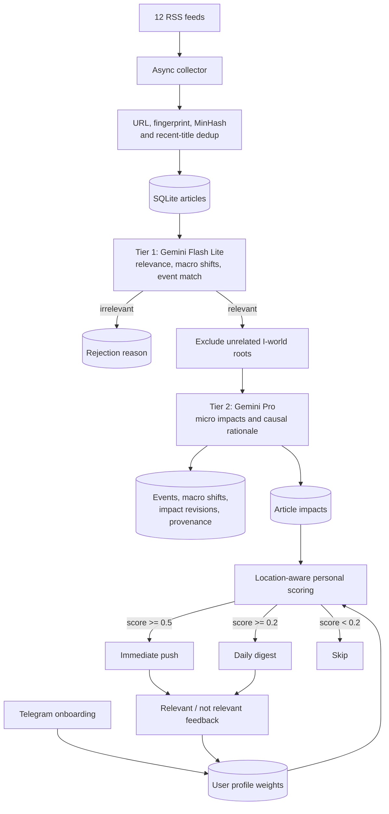

# Impact News

Impact News is a causal news-personalization engine for India. It asks a different question from a
typical topic recommender: not “does this match a user's interests?”, but “what could this change in
the user's wallet, work, travel, health, home, or daily routine?”

The system collects RSS articles, filters low-impact stories, maps relevant events from macro
triggers to citizen-level effects with Gemini, scores those effects against a Telegram user's
profile, and learns from delivery feedback. Articles, events, profiles, matches, and feedback are
kept in a local SQLite database.

## Why this exists

Most news feeds learn what keeps a person clicking. That is not the same as learning what could change their life. A refinery outage may look like an energy story, but for one reader it means a higher commute cost; a policy change may matter because it affects their rent, medicine, job sector, or tax filing.

Impact News started from one line: **Not what interests you. What affects you.** The project tries to connect a large event to its ordinary consequences, then rank those consequences against a person's location and life context. The intended experience is a smaller feed with a better reason for every notification: why this event may reach you, through which chain, and on what timescale.

That requires more than topic matching. The separate trigger and impact taxonomies, two-stage analysis, event history, and feedback loop exist to preserve the causal path and improve it over time. The system is still a research prototype, but the product question is consumer-facing: can news help someone prepare for a real effect instead of merely keeping them informed?

## What is implemented

- Concurrent collection from 12 configured economy, finance, business, India, and world RSS feeds.
- Exact URL/fingerprint deduplication plus MinHash and title-similarity checks.
- A two-tier LLM pipeline: inexpensive relevance and trigger classification first, deeper causal
  impact analysis only for articles that pass.
- A checked-in T/I taxonomy with 381 nodes: 175 macro trigger nodes across seven T-world roots and
  206 citizen impact nodes across eight I-world roots.
- Event tracking with macro-shift trajectories, immutable impact revisions, article provenance,
  and a current-state view.
- Telegram onboarding that turns five answers into weighted impact-node preferences, including
  city-tier and seasonal defaults.
- Location-aware article scoring, immediate push and daily digest tiers, and feedback-driven profile
  adjustments with diagnostic follow-up questions.
- Offline evaluation code for relevance, trigger selection, impact recall, precision, and ranking.

## Architecture



### The taxonomy model

The taxonomy separates two kinds of concepts:

- T-world nodes describe system-level changes a person does not directly experience, such as a
  monsoon pattern, central-bank action, commodity move, regulation, or geopolitical disruption.
- I-world nodes describe the concrete effects a person can experience, such as fuel prices, rent,
  commute disruption, job availability, or healthcare access.

Tier 1 receives the T-world tree and emits one or more `macro_shifts` with a trajectory and context.
It can exclude irrelevant I-world root categories before Tier 2 runs. Tier 2 then emits flat
`micro_impacts`, each with an I-node, probability, magnitude, delay, trajectory, rationale,
geographic scope, and the T-nodes that drive it. Outputs are validated against
`data/merged_graph.yaml` before storage.

### Event state and provenance

`pipeline.ingest` is the event-aware analysis path. Tier 1 sees up to 50 active events. A confident
match sends compressed event state to Tier 2, which appends impact revisions and updates the event;
otherwise the pipeline creates a new event. Articles support macro shifts and impacts through
linking tables rather than overwriting their history. The `current_micro_impacts` view selects the
latest revision for each event and I-node.

### Personal scoring

Onboarding combines universal weights, city-tier and seasonal activations, and explicit answers.
For each article impact, the matcher computes:

```text
impact score   = probability × magnitude
personal score = impact score × user weight
article score  = min(sum(top 3 personal scores) / 2, 1)
```

City- and state-scoped impacts are filtered against the profile location. Scores of `0.5` or more
are push notifications, scores from `0.2` to `0.5` enter the digest tier, and lower scores are not
delivered. Feedback can adjust node weights while preserving a floor for universal needs.

## Technology

| Area | Implementation |
|---|---|
| Runtime | Python 3.12 in the supplied container |
| Configuration | Pydantic Settings with `.env` loading |
| Collection | `feedparser` with concurrent feed fetches |
| Deduplication | SHA-256 IDs/fingerprints and `datasketch` MinHash LSH |
| LLMs | Google GenAI SDK; separate Flash Lite and Pro model settings |
| Taxonomy | YAML, PyYAML, and NetworkX for graph merging |
| Persistence | SQLite in WAL mode with foreign keys enabled |
| Delivery | `python-telegram-bot` polling and job queue |
| Packaging | `requirements.txt`, Dockerfile, and Docker Compose |

## Repository layout

| Path | Role |
|---|---|
| `main.py` | Database initialization, one-shot collection, and Telegram bot entry point |
| `config.py` | RSS sources, model names, paths, schedule, and score thresholds |
| `pipeline/collector.py` | RSS fetch, cleanup, deduplication, and article storage |
| `pipeline/ingest.py` | Event-aware two-tier analysis CLI |
| `pipeline/run.py` | Single-pass collect, analyze, score, and direct-delivery runner |
| `pipeline/database.py` | SQLite schema and article, match, profile, and feedback operations |
| `pipeline/events.py` | Event creation, updates, revisions, provenance, decay, and current state |
| `engine/classifier.py` | Tier 1 relevance, macro-shift, exclusion, and event-match parsing |
| `engine/llm_engine.py` | Tier 2 impact analysis, retry logic, and taxonomy validation |
| `engine/prompts/` | Tier 1, new-event, and event-update prompt builders |
| `engine/taxonomy_context.py` | T/I hierarchy formatting, filtering, and node lookups |
| `profiling/` | Questionnaire schema, city defaults, matching, and feedback diagnostics |
| `bot/bot.py` | Telegram onboarding, profile display, delivery jobs, and feedback callbacks |
| `taxonomy/` | Source T- and I-world YAML files |
| `data/merged_graph.yaml` | Runtime taxonomy artifact |
| `tests/eval/` | Tier 1 and Tier 2 labeled cases, runners, and checked-in result snapshots |

## Setup

### Local Python

```bash
git clone https://github.com/tarangdeep-goel-by/impact-news.git
cd impact-news

python3 -m venv .venv
source .venv/bin/activate
python -m pip install -r requirements.txt
```

Create `.env` in the repository root:

```dotenv
GEMINI_API_KEY=replace-with-a-google-gemini-key
TELEGRAM_BOT_TOKEN=replace-with-a-telegram-bot-token
TELEGRAM_CHAT_ID=replace-with-a-default-chat-id
```

`GEMINI_API_KEY` is required for classification and analysis. The Telegram values are required for
bot polling and delivery; collection and read-only statistics do not use them. Other settings in
`config.py`, including `DB_PATH`, `GRAPH_PATH`, `GEMINI_MODEL`, `GEMINI_PRO_MODEL`, and
`DIGEST_HOUR`, can also be overridden through environment variables.

### Docker

The Compose service builds the image, mounts the repository at `/app`, loads `.env`, and stays idle
so commands can be run explicitly:

```bash
docker compose up --build -d
docker compose exec app python main.py collect
docker compose exec app python -m pipeline.ingest --stats
```

## Run the system

### 1. Collect articles

```bash
python main.py collect
```

The collector fetches all configured feeds, removes duplicates, inserts new rows into
`data/impact_news.db`, and records an execution log.

### 2. Analyze articles and build event state

```bash
# Up to 100 source-balanced, unprocessed articles.
python -m pipeline.ingest

# Common alternatives.
python -m pipeline.ingest --limit 20
python -m pipeline.ingest --all
python -m pipeline.ingest --stats
python -m pipeline.ingest --events
```

This path performs event matching and updates existing event state when Tier 1 returns a confident
match. API and parse failures are retried up to four times; rate-limit and service-unavailable
responses use exponential backoff.

### 3. Create a Telegram profile

```bash
python main.py bot
```

Open the bot in Telegram and send `/start`. The onboarding flow asks for city, work, transport,
housing, and family context. `/profile` shows the resulting highest-weight nodes. The bot checks for
high-priority matches every five minutes and sends medium-priority matches at `DIGEST_HOUR`.

`python main.py run` is currently an alias for the same bot process; it does not start the analysis
pipeline.

### 4. Run the convenience end-to-end pipeline

With at least one profile in the database:

```bash
python -m pipeline.run --collect --limit 20
```

Use `--dry-run` to suppress Telegram sends while inspecting decisions:

```bash
python -m pipeline.run --limit 20 --dry-run
```

Dry-run still writes classifications, events, matches, and processed flags to SQLite. It is not a
read-only preview.

## Storage model

The main tables are:

| Tables | Contents |
|---|---|
| `articles`, `seen_hashes`, `execution_logs` | Collected content, dedup keys, and collection runs |
| `article_impacts` | Per-article relevance, triggers, impacts, rejection reason, event, and LLM timings |
| `events`, `event_articles` | Event summary, lifecycle stage, denormalized current state, and supporting articles |
| `macro_shifts`, `micro_impact_revisions` | Current T-world trajectories and append-only I-world revisions |
| `shift_support`, `impact_support`, `impact_drivers` | Article provenance and T-to-I driver relationships |
| `user_profiles` | Telegram identity, location, raw answers, and node weights |
| `article_matches` | Personal scores, matched nodes, delivery status, and feedback |
| `profile_feedback_log` | Diagnostics, depth answers, and weight adjustments |

By default, all of this is stored in `data/impact_news.db`.

## Evaluation and verification

The eval runners call the configured Gemini models unless `--dry-run` is supplied:

```bash
# Inspect labeled datasets without API calls.
python -m tests.eval.tier1_eval --dry-run
python -m tests.eval.tier2_eval --dry-run

# Run live model evaluations. These consume API quota and overwrite result snapshots.
python -m tests.eval.tier1_eval
python -m tests.eval.tier2_eval

# Syntax/import-bytecode check without running the network pipeline.
python -m compileall -q .
```

The checked-in snapshots currently contain 190 Tier 1 cases and 20 Tier 2 cases. They record Tier 1
relevance precision `0.752`, recall `0.913`, and F1 `0.825`; the Tier 2 snapshot records mean
NDCG@10 `0.673`, Recall@10 `0.570`, and Precision@10 `0.444`. Treat these as saved experimental
artifacts, not current production guarantees: outputs depend on preview model versions, prompts,
taxonomy, and the labeled set.

## Current boundaries

- This is a working research prototype, not a hosted service. SQLite is local and synchronous; no
  migration framework, API server, authentication layer, or deployment automation is included.
- The bot schedules delivery of existing matches. It does not schedule RSS collection or LLM
  analysis; run those separately or add an external scheduler.
- `pipeline.run` operates on the first stored user profile and always creates a new event. Use
  `pipeline.ingest` for multi-article event matching and updates.
- The confidence-filter module exists, but the unified runner currently scores the analyzer's raw
  `micro_impacts`; its imported filter is not applied in that path.
- LLM classifications and causal estimates can be wrong. The taxonomy validation drops unknown
  I-node IDs, but it does not establish factual truth or verify an article's claims.
- RSS availability and third-party preview model names can change. Feed failures are logged and the
  collector continues with the remaining sources.
- The repository has evaluation runners rather than a conventional unit-test suite. Live evals
  require network access, API quota, and can vary across runs.

## Security and data handling

- Keep `.env` out of version control. The included `.gitignore` excludes it, but you remain
  responsible for secret rotation and local file permissions.
- Article titles and summaries are sent to Google Gemini. Telegram receives delivered headlines,
  rationale, scores, links, and interactive feedback controls.
- Profile answers, Telegram chat IDs, matches, and feedback are stored unencrypted in the local
  SQLite file. Do not treat the default database as a multi-tenant or regulated-data store.
- Review LLM output and source articles before using the system for financial, health, legal, or
  safety decisions.
